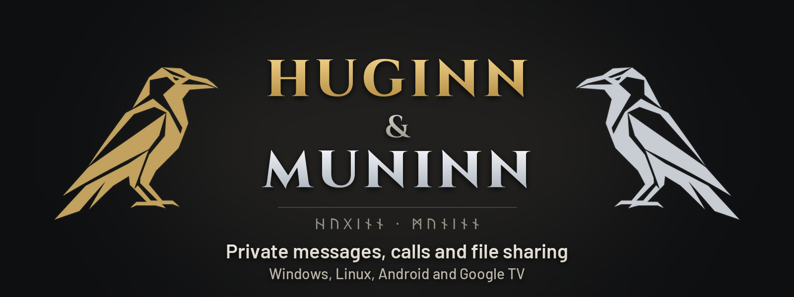
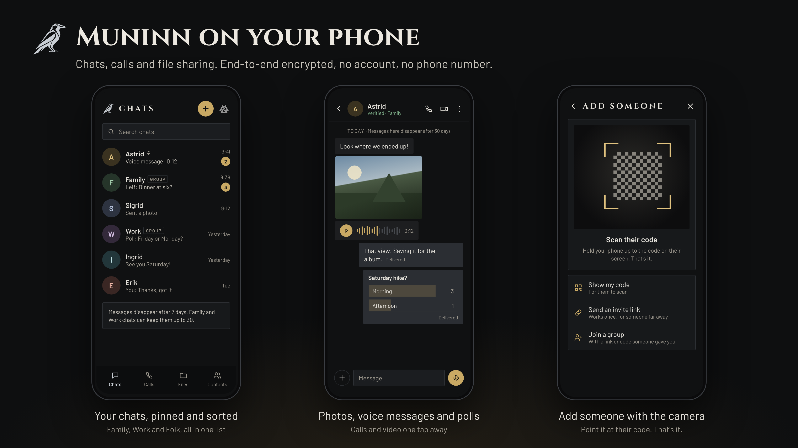
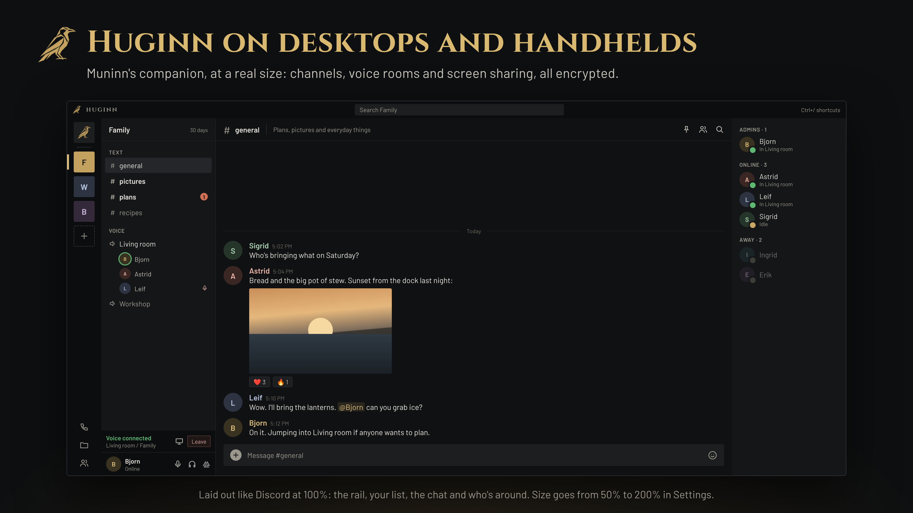
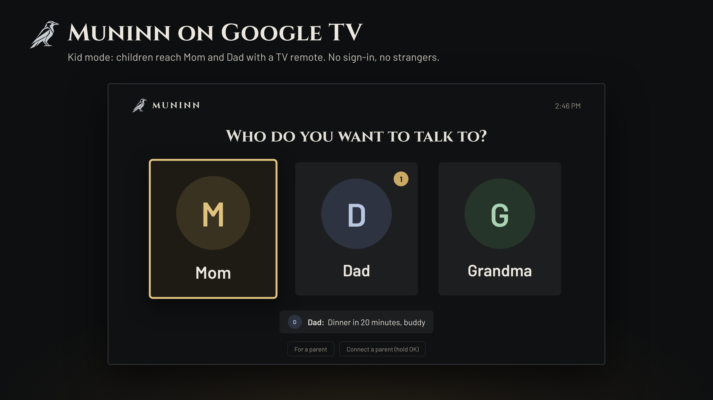
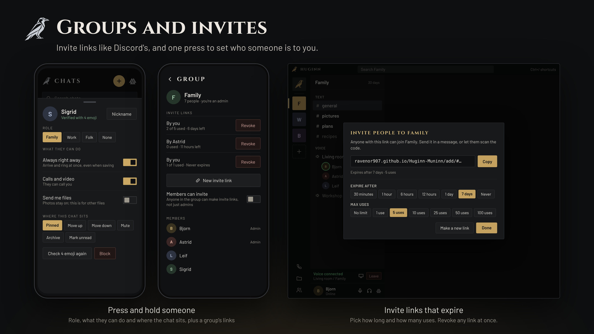

<p align="center"></p>

# Huginn-Muninn

Open-source private messenger. No accounts. No phone numbers. No ads. No tracking.

**Download:** [Muninn.apk](https://github.com/Ravenor907/Huginn-Muninn/releases/latest/download/Muninn.apk) · [Huginn-Windows.zip](https://github.com/Ravenor907/Huginn-Muninn/releases/latest/download/Huginn-Windows.zip) · [Huginn.flatpak](https://github.com/Ravenor907/Huginn-Muninn/releases/latest/download/Huginn.flatpak)

## What it does

- End-to-end encrypted chats and groups. Photos, files, voice and video messages.
- Voice and video calls. Group video up to 4. Drop-in voice rooms.
- File sharing, straight between devices when it can.
- Works over internet relays, or nearby over Wi-Fi and Bluetooth with no internet at all.
- Kids' TV: Google TV mode where kids reach only the people their parents allow.

## Where it runs

Muninn: Android phones, tablets and Google TV.  
Huginn: Windows and Linux, desktops and handhelds.

One identity across all of them. Link devices, or move everything to a new one.

## Screens

<p align="center"></p>
<p align="center"></p>
<p align="center"></p>
<p align="center"></p>
<p align="center"></p>

## Privacy

- Keys are made on your device. Nothing to sign up for.
- Messages expire on their own: 7 days, up to 30 in Family and Work chats.
- Relays carry sealed messages they can't read.
- What leaves your device: sealed messages to public Nostr relays. Calls through a Cloudflare relay, or straight between trusted contacts, encrypted either way. One STUN lookup to find a direct path for files. Update checks to GitHub (can be turned off).

## Install

Android: open Muninn.apk on the device and install it.  
Windows: unzip Huginn-Windows.zip anywhere, run Huginn.exe.  
Linux:

```
cd ~/Downloads && curl -LO https://github.com/Ravenor907/Huginn-Muninn/releases/latest/download/Huginn.flatpak && flatpak install --user -y Huginn.flatpak
```

Every release is signed. Both apps refuse an update that doesn't match. Check a download yourself: [shared/docs/releases.md](../code/shared/docs/releases.md).

## Security

Found a problem? Report it privately: [SECURITY.md](SECURITY.md).

## Build

Huginn: CMake, Qt 6.10, vcpkg (Windows) or `flatpak-builder` with `code/huginn/packaging/io.github.ravenor907.Huginn.json` (Linux).  
Muninn: Gradle, from `code/muninn/`.  
Protocol: [shared/docs/protocol-0.6.md](../code/shared/docs/protocol-0.6.md).

GPL-3.0. Fonts: Cinzel, Barlow and Noto Sans Runic (SIL Open Font License).

---

Two ravens. Your contacts. Your conversations. Your way.
