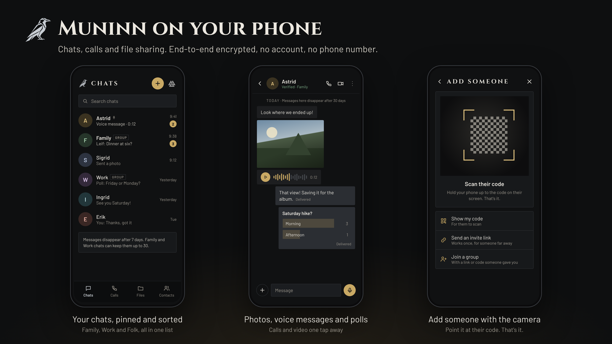
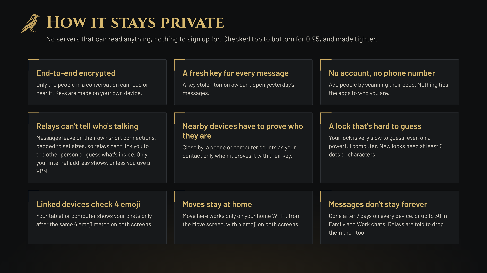
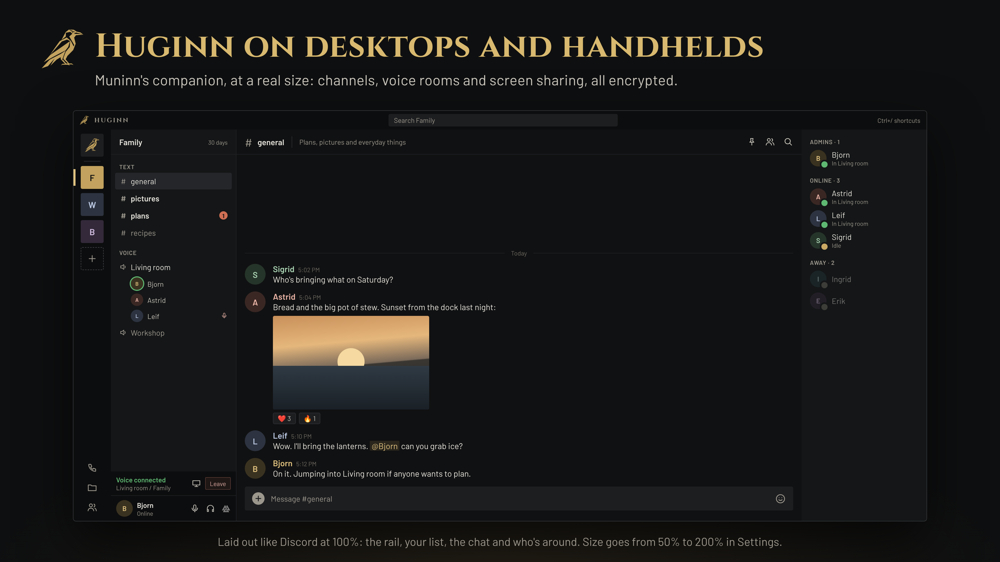

<p align="center">
  
</p>

<p align="center">
  <a href="https://github.com/Ravenor907/Huginn-Muninn/releases"></a>
  <a href="https://github.com/Ravenor907/Huginn-Muninn/actions/workflows/build.yml"></a>
  <a href="LICENSE"></a>
</p>

<h3 align="center">Private communications. Your people. Your devices.</h3>

<p align="center">
  <a href="https://github.com/Ravenor907/Huginn-Muninn/releases/latest/download/Muninn.apk"><b>Muninn for Android</b></a> &nbsp;·&nbsp;
  <a href="https://github.com/Ravenor907/Huginn-Muninn/releases/latest/download/Huginn-Windows.zip"><b>Huginn .exe</b></a> &nbsp;·&nbsp;
  <a href="https://github.com/Ravenor907/Huginn-Muninn/releases/latest/download/Huginn.flatpak"><b>Huginn Flatpak</b></a>
</p>

Your conversations are your business. Your personal information is yours to protect.

Huginn-Muninn is a private, open-source, cross-platform communications platform for individuals, families, friends and communities who want more control over how they communicate.

**No accounts. No phone numbers. No advertising. No analytics. No user tracking.**

Just communication between the people you choose to connect with.

## Communication Without Compromise

**Messaging**
- Private conversations and group chats.
- Photos, albums, files and voice messages.
- Video messages, reactions, replies and polls.
- Group channels, member management and invite links.

**Voice and Video**
- Private voice and video calls.
- Group video calls for up to four people.
- Drop-in group voice rooms.
- Calls that ring in the background, with battery-conscious notifications.

**File Sharing**
- Direct device-to-device transfers when available.
- Encrypted transfers across the internet.
- Nearby sharing over local Wi-Fi and Bluetooth.

**Contacts**
- QR code and invitation-based contacts.
- Meet close by and keep in touch, no code needed.
- Custom contact roles and permissions.
- Control who can call, message or share files with you.

<p align="center"></p>

## Privacy by Design

Your personal information shouldn't be the product.

- No accounts, phone numbers or email registration.
- End-to-end encrypted messages, calls and file transfers.
- Identities and keys made on your own device.
- Local storage encrypted under your own Huginn or Muninn lock, not an outside service.
- Public relays carry sealed messages they can't read.
- Separate sending connections keep relays from linking senders and recipients.
- Messages expire automatically, with retention you choose.
- No advertising, analytics or behavioral tracking.

<p align="center"></p>

## Built for More Than One Kind of User

**Individuals.** Take control of your communications without accounts, phone numbers or advertising-driven platforms.

**Families.** Keep parents, children and relatives connected. Parent-managed contacts, permissions and a dedicated Google TV interface keep children in touch with approved family members.

**Friends and communities.** Private groups, file sharing, organized conversations and voice rooms, without a social network.

**Small teams.** Private messaging, group channels, voice rooms and file sharing across different devices and operating systems.

**Travelers.** Talk between nearby devices over local Wi-Fi and Bluetooth, even with no internet.

## Communication Without Platform Gatekeepers

Your ability to reach your own contacts shouldn't depend on an account in good standing with a social media company.

- No central account to suspend.
- No algorithmic feed deciding which conversations you see.
- No advertising-driven ranking.
- Open-source software anyone can inspect, maintain and develop.

## One Communication Ecosystem

**Muninn** runs on Android phones, tablets and Google TV. **Huginn** is the companion of Muninn, for desktops and handhelds: get the .exe or the Flatpak.

Both share the same identity. Link several devices, move your identity to a new one, and keep your contacts and conversations together.

<p align="center"></p>

## Installation

**Android:** open [Muninn.apk](https://github.com/Ravenor907/Huginn-Muninn/releases/latest/download/Muninn.apk) on the phone, tablet or TV and install it.

**Windows:** download [Huginn-Windows.zip](https://github.com/Ravenor907/Huginn-Muninn/releases/latest/download/Huginn-Windows.zip), extract it and run `Huginn.exe`.

**Linux:**

```
cd ~/Downloads && curl -LO https://github.com/Ravenor907/Huginn-Muninn/releases/latest/download/Huginn.flatpak && flatpak install --user -y Huginn.flatpak
```

Every release is signed, and both apps refuse an update that doesn't match. Update checks can be turned off. To check a download yourself: [Releases](docs/releases.md).

## Security

Found a problem? Report it privately: see [SECURITY.md](SECURITY.md).

What leaves your device, and only to do what you asked: sealed messages to public Nostr relays; calls through the Cloudflare call relay, or straight between trusted contacts, end-to-end encrypted either way; one STUN request to find a direct path for files; update checks to GitHub; link previews from the sender's device, only if turned on.

## Independent and Open Source

GPL-3.0. No advertising business model, no monetized conversations, no corporate account. Privacy isn't a premium subscription. It's the point.

Building it yourself: Windows uses CMake, Qt 6.10 and vcpkg; Linux uses `flatpak-builder` with `packaging/io.github.ravenor907.Huginn.json`; Muninn uses Gradle from `android/`. The wire protocol is in [docs/protocol-0.6.md](docs/protocol-0.6.md). Fonts: Cinzel, Barlow and Noto Sans Runic, under the SIL Open Font License.

---

<p align="center"><b>Huginn and Muninn. Thought and Memory.</b><br>
Two ravens that travel the world and return with knowledge.<br>
Your conversations. Your connections. Your privacy.</p>
