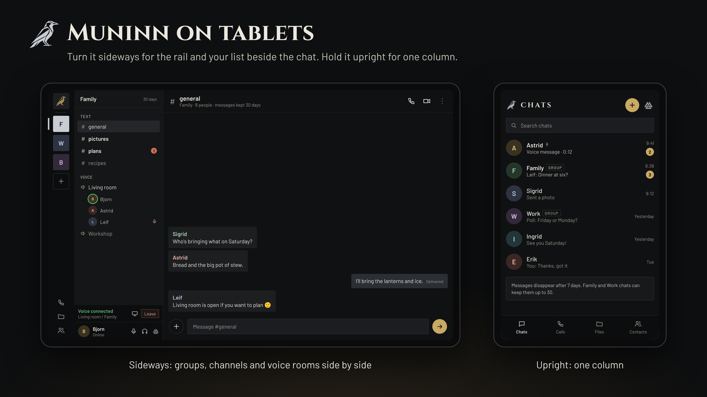
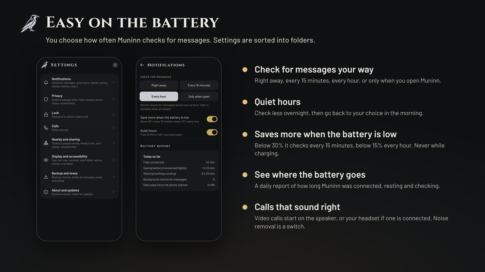
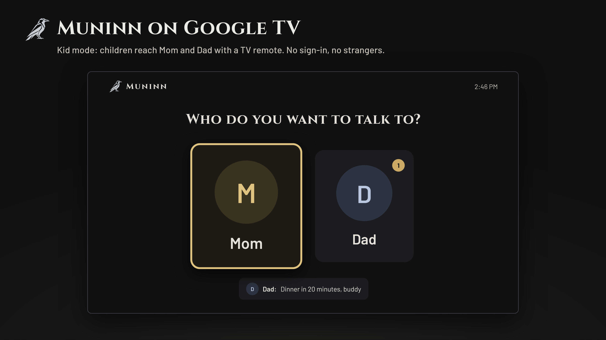
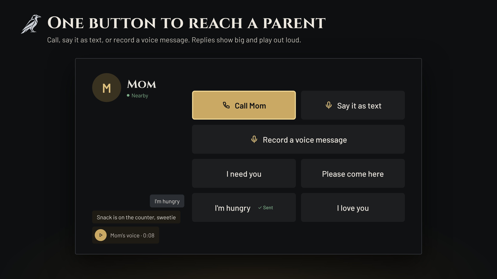
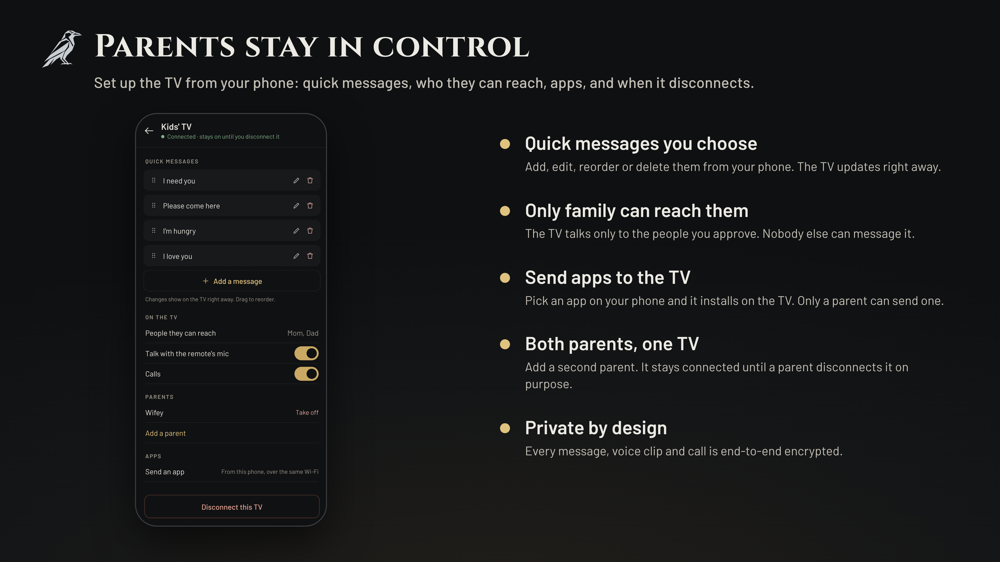

<p align="center">
  
</p>

<p align="center">
  <a href="https://github.com/Ravenor907/Huginn-Muninn/releases"></a>
  <a href="https://github.com/Ravenor907/Huginn-Muninn/actions/workflows/build.yml"></a>
  <a href="LICENSE"></a>
</p>

<h3 align="center">Private messaging for the people you care about.</h3>

<p align="center">
  Chats, calls, video and file sharing, end-to-end encrypted.<br>
  No accounts. No phone numbers. No ads. No tracking. Nothing to sign up for.
</p>

<p align="center">
  <a href="https://github.com/Ravenor907/Huginn-Muninn/releases/latest/download/Muninn.apk"><b>Muninn for Android and Google TV</b></a> &nbsp;·&nbsp;
  <a href="https://github.com/Ravenor907/Huginn-Muninn/releases/latest/download/Huginn-Windows.zip"><b>Huginn for Windows</b></a> &nbsp;·&nbsp;
  <a href="#install"><b>Huginn for Linux</b></a>
</p>

Odin sends two ravens out every morning: Huginn (thought) and Muninn (memory). They fly the world and bring back what he needs to know.

These two carry your messages. **Muninn** runs on Android phones, tablets and Google TV. **Huginn** runs on Windows and Linux computers. Together they are a private place for your family and friends to keep in touch, with nobody in the middle who can read it.

## Keep in touch

- **Chats and groups:** messages, photos, albums, voice and video messages, polls, reactions and replies. Groups have their own channels.
- **Calls:** voice and video calls, group calls, and voice rooms people drop in and out of. Group video works for up to 4 people.
- **Files:** send files to someone across the room or across the country. They go straight from your device to theirs.
- **Easy to add the people you trust:** share your code or QR, send an invite link that works once, tap phones together, or let someone you both know introduce you.
- **All your screens:** your phone, a tablet or second phone linked to it, and your computer.
- **Kids' TV:** turn a Google TV into a simple screen your kids use to reach the people you approve.

## Private by default

<p align="center"></p>

- **Only the people talking can read or hear it.** Every message, photo, voice note, call and file is end-to-end encrypted, with a fresh key for every message.
- **No account.** You are a key made on your own device, not a phone number or email address. Strangers without your code can't reach you.
- **Works with or without the internet.** Close by, your devices talk over Wi-Fi and Bluetooth. Apart, sealed messages travel through free public relays that can't see who sent them or what they say.
- **Your address stays yours.** Calls with people you haven't chosen to trust go through a relay, so they never see your IP address.
- **Locked on your device.** A pattern or password opens the app, and everything it keeps is encrypted. Panic lock locks it all in a moment.
- **Messages don't stay forever.** Chats delete messages, photos, voice clips, videos and files after 7 days on every device, and backups leave them out. Family and Work groups, and people in your Family or Work folder, can keep them up to 30 days.
- **Free and open.** GPL-3.0, no ads, no analytics, no tracking.

## On every screen you have

<p align="center"></p>
<p align="center"></p>
<p align="center"></p>

## Easy on the battery

<p align="center"></p>

## Kids' TV

Muninn can also turn a Google TV into a simple screen your kids can use to reach Mom and Dad. No sign-in, no strangers, no ads: big buttons for a TV remote, and only the people a parent approves. Parents set it up and manage it from their own phones.

<p align="center"></p>
<p align="center"></p>
<p align="center"></p>

## What's new in 0.93

| | |
|---|---|
| **Albums and a camera inside the app** | Pick several photos at once and they arrive as one album. Take photos with Muninn's own camera, with a front/back flip, without the picture landing in your gallery. |
| **Video messages** | Record up to a minute, watch it back, then choose Send or Discard. Nothing is sent until you tap Send. |
| **Polls** | Ask a question with up to 10 answers, in a chat or a group, and see who voted for what. |
| **Link previews** | A link shows its title and picture. Your phone makes the preview, so the other person's phone never visits the site. Turn it off under Settings › Privacy. |
| **Shared photos, videos and links** | Every chat has a page with everything that's been shared in it. |
| **Requests in their own list** | People who have your code but aren't contacts yet, introductions and group invites wait under Requests until you say yes. |
| **Easier to add the people you trust** | Invite links that work once, introductions ("Mom wants to introduce you to Grandma", and you both say yes), an offer to add the people in your Family group, tapping phones together, and 4 matching emoji to check it's really them. |
| **Files over the internet** | Send a file of up to 4 GB straight to a contact's phone, wherever they are. Small files can also go in pieces through the free relays. Files never go through our server. |
| **Group video** | Turn on the camera in a voice room with up to 4 people. Video goes straight between phones; anyone who can't connect directly stays on voice. |
| **Linked devices** | Use your chats on a tablet or second phone. It shows your phone's chats and sends through it while your phone is on and online. |
| **Mute, archive and mark as unread** | Hold a chat for the options. Rename people from the chat list too, and give each chat its own color. |
| **Refresh buttons** | Check for new messages, or look for phones nearby again, with one tap. |
| **Kinder to your battery** | Follow Do Not Disturb, check less when nothing has happened for a while, a mobile data saver, and backups and Kids' TV updates only while charging. |
| **Folk** | The third starting folder is now called Folk. |
| **No location prompt** | Muninn no longer asks for location on Android 13 and newer. Older phones are asked only when you turn on Nearby. |

Every earlier release is in [What changed](docs/CHANGELOG.md).

## Install

Both apps come out together with the same version number, and both update themselves when they open.

**Muninn on Android and Google TV:** open this link on the device and install it:
https://github.com/Ravenor907/Huginn-Muninn/releases/latest/download/Muninn.apk

**Huginn on Windows:** download [Huginn-Windows.zip](https://github.com/Ravenor907/Huginn-Muninn/releases/latest/download/Huginn-Windows.zip), unzip it anywhere and run `Huginn.exe`. Nothing to install.

**Huginn on Linux** (in a terminal):

```
cd ~/Downloads && curl -LO https://github.com/Ravenor907/Huginn-Muninn/releases/latest/download/Huginn.flatpak && flatpak install --user -y Huginn.flatpak
```

Huginn also works with a game controller or TV remote: see [Using Huginn with a controller](docs/controller.md).

## For developers

Versions use one dot, read as a decimal (0.92, 0.93, then 1.0). The `VERSION` file on main decides releases for both apps: change it and CI builds, tests and publishes them together. 1.0 comes once everything has been tested on every device.

```
tools/get-fonts.sh
flatpak-builder --user --install --force-clean build packaging/io.github.ravenor907.Huginn.json
```

Windows builds with CMake, Qt 6.10 and vcpkg (see the Windows job in `.github/workflows/build.yml`). Muninn builds with Gradle from `android/`. The wire protocol is in [docs/protocol-0.6.md](docs/protocol-0.6.md).

## Code signing policy

Free code signing provided by [SignPath.io](https://about.signpath.io/), certificate by [SignPath Foundation](https://signpath.org/).

Windows builds (Huginn.exe in Huginn-Windows.zip) are built from this repository by GitHub Actions and signed only after a person approves each release.

- Committers and reviewers: [Ravenor907](https://github.com/Ravenor907)
- Approvers: [Ravenor907](https://github.com/Ravenor907)

## Privacy

Huginn and Muninn collect nothing about you: no accounts, no analytics, no ads, no tracking. This program will not transfer any information to other networked systems unless specifically requested by the user or the person installing or operating it. What leaves your device, and only to do what you asked:

- **Messages, photos and voice clips** are end-to-end encrypted and sealed before they reach the public Nostr relays that carry them. Relays see only a sealed mailbox id and the IP address that connects to them.
- **How long messages stay**: 7 days, or up to 30 in Family and Work chats, then they are deleted on every device. Each app tells the other how long it keeps a chat, next to the list of features it understands.
- **Calls** go through the Cloudflare call relay ([Cloudflare privacy policy](https://www.cloudflare.com/privacypolicy/)), or straight between devices for contacts you trust. Audio and video are end-to-end encrypted. The relay login service keeps no logs.
- **Updates** are downloaded from GitHub ([GitHub privacy statement](https://docs.github.com/site-policy/privacy-policies/github-general-privacy-statement)).
- **Files over the internet** go straight between the two devices, end-to-end encrypted. To find a direct path, each device asks a public STUN server (Cloudflare's) for its own internet address; the file itself never goes through it. Small files that can't go straight travel in sealed pieces through the Nostr relays.
- **Link previews** are made on the sender's phone, which fetches the page, so that site sees the sender's IP address. Turn them off in Settings › Privacy.
- **Nearby sharing** stays on your home Wi-Fi or Bluetooth.

## License

GPL-3.0. Fonts: Cinzel, Barlow and Noto Sans Runic, under the SIL Open Font License.
