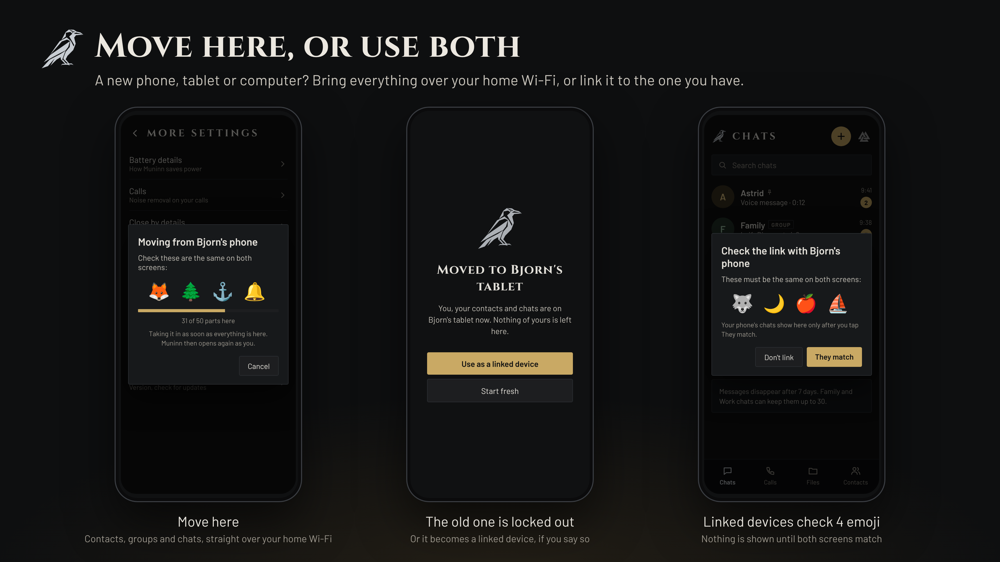
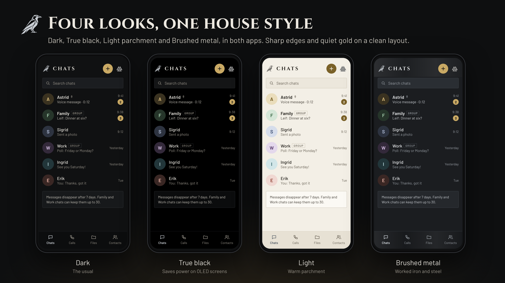

<p align="center">
  
</p>

<p align="center">
  <a href="https://github.com/Ravenor907/Huginn-Muninn/releases"></a>
  <a href="https://github.com/Ravenor907/Huginn-Muninn/actions/workflows/build.yml"></a>
  <a href="LICENSE"></a>
</p>

<h3 align="center">Private messaging for the people you care about.</h3>

<p align="center">
  Chats, calls, video and file sharing, end-to-end encrypted.<br>
  No accounts. No phone numbers. No ads. No tracking. Nothing to sign up for.
</p>

<p align="center">
  <a href="https://github.com/Ravenor907/Huginn-Muninn/releases/latest/download/Muninn.apk"><b>Muninn for Android</b></a> &nbsp;·&nbsp;
  <a href="https://github.com/Ravenor907/Huginn-Muninn/releases/latest/download/Huginn-Windows.zip"><b>Huginn .exe</b></a> &nbsp;·&nbsp;
  <a href="https://github.com/Ravenor907/Huginn-Muninn/releases/latest/download/Huginn.flatpak"><b>Huginn Flatpak</b></a>
</p>

Odin sends two ravens out every morning: Huginn (thought) and Muninn (memory). They fly the world and bring back what he needs to know.

These two carry your messages. **Muninn** runs on Android phones, tablets and Google TV. **Huginn** is the companion of Muninn, for desktops and handhelds: get the .exe or the Flatpak. Together they are a private place for your family and friends to keep in touch, with nobody in the middle who can read it.

Both apps share one look: sharp edges, a touch of the old north, and a clean, modern layout. Settings fit on one short page, in plain words.

## Keep in touch

- **Chats and groups:** messages, photos, albums, voice and video messages, polls, reactions and replies. Groups have their own channels, voice rooms and a member list that shows who's around.
- **Calls:** voice and video calls, group calls, and voice rooms people drop in and out of. Group video works for up to 4 people.
- **Files:** send files to someone across the room or across the country. They go straight from your device to theirs.
- **Easy to add the people you trust:** point the camera at their code, send an invite link that works once, tap phones together, or let someone you both know introduce you.
- **Group invite links:** like Discord's. Pick how long a link lasts (30 minutes up to never) and how many people can use it, see every link that's out there, and revoke any of them at once. Admins can let members make links too.
- **Press and hold someone** (right-click on a computer) to set who they are to you: Family, Work or Folk, what they may do (calls, video, files, Always right away), where their chat sits (pin, move, mute, archive), a nickname and a color. Block is there too.
- **Move here:** got a new phone, tablet or computer? Everything comes over your home Wi-Fi: you, your contacts, groups and chats. Your contacts don't have to add you again. The old device is locked out, or becomes a linked device if you say so.
- **Use both:** link a tablet, second phone or computer to your phone. The same 4 emoji show on both screens before anything is shared.

<p align="center"></p>
<p align="center"></p>

## Private by default

<p align="center"></p>

- **Only the people talking can read or hear it.** Every message, photo, voice note, call and file is end-to-end encrypted, with a fresh key for every message.
- **No account.** You are a key made on your own device, not a phone number or email address. Strangers without your code can't reach you.
- **Works with or without the internet.** Close by, your devices talk over Wi-Fi and Bluetooth. Apart, sealed messages travel through free public relays.
- **Relays can't tell who's talking to whom.** Messages go out on their own short connections, padded to a few fixed sizes, so a relay can't link sender and receiver or guess what a message is. Only your internet address shows, unless you use a VPN.
- **Your address stays yours on calls.** Calls with people you haven't chosen to trust go through a relay, so they never see your internet address.
- **A lock that's hard to guess.** A pattern or password opens the app, and everything it keeps is encrypted. On a phone the lock is tied to its security chip, and on a computer it's built to be very slow to guess. Panic lock locks it all in a moment.
- **Safe moves and links.** Move here works only on your home Wi-Fi, and linked devices are checked with 4 emoji on both screens.
- **Messages don't stay forever.** Chats delete messages, photos, voice clips, videos and files after 7 days on every device, and backups leave them out. Family and Work chats can keep them up to 30 days. Relays are told to drop them when that time is up too.
- **Checked top to bottom.** For 0.95 both apps were gone through for security problems and made tighter.
- **Free and open.** GPL-3.0, no ads, no analytics, no tracking.

## On every screen you have

The layout follows how you hold the screen. Upright, on a phone or a tablet, you get one column. Sideways, on a tablet or a computer, you get the rail with your groups, your list beside it and the conversation. Kids' TV keeps its own big-button layout.

<p align="center"></p>
<p align="center"></p>
<p align="center"></p>

On a computer Huginn is laid out like Discord at its normal size: the rail, your list, the conversation and the member list, each panel resizable. Size goes from 50% to 200% in Settings (or Ctrl+= and Ctrl+-). Huginn also works with a game controller: see [Using Huginn with a controller](docs/controller.md).

Pick the look you like in Settings › Look and text size: **Dark**, **True black**, **Light** (parchment) or **Brushed metal**.

<p align="center"></p>

## Easy on the battery

<p align="center"></p>

- **One choice:** Fastest, Balanced or Extreme battery saver. Even the biggest saver keeps one light connection, so calls still ring almost at once.
- **Messages on time, without Google.** No Google push. Muninn keeps its own light connection and wakes the phone only when it must.
- **Always right away** for the people you pick, even on a low battery or in quiet hours.
- **A battery report** shows what Muninn kept running today and roughly what it cost.
- **Smaller downloads.** Muninn and Huginn both got lighter in 0.95.

## Kids' TV

Muninn can also turn a Google TV into a simple screen your kids can use to reach Mom and Dad. No sign-in, no strangers, no ads: big buttons for a TV remote, and only the people a parent approves. Parents set it up and manage it from their own phones, including how much room noise is taken out of the kids' voice on calls.

Lost or reset your phone? Another parent lets you back in with one tap. If no parent is left, the TV shows a code behind a 5-second hold on the remote, so a child can't open it by accident.

<p align="center"></p>
<p align="center"></p>
<p align="center"></p>

## What's new in 0.94

| | |
|---|---|
| **Messages on time, without Google** | In the background Muninn now keeps one light connection to the healthiest relay, checked about every 5 minutes and lined up with the phone's other wake-ups, and swaps to another relay at once if it stops answering. It never falls back to checking every 15 minutes or every hour unless you pick that in Settings. |
| **Always right away** | Your Family folder to start with, and anyone you add (Settings › Notifications, or a chat's menu). A low battery, quiet hours and checking less never hold their messages back. During quiet hours everyone else's messages arrive without a sound. |
| **Replies come at once** | For about 5 minutes after you send or get a message, Muninn stays fully connected so the conversation flows. |
| **Catches up instantly** | When you unlock the phone, when it joins a network, and when you open Muninn. |
| **Honest ticks** | "Delivered" means it reached their phone. Until then it says "Waiting for Anna's phone". In groups, the message's menu shows whose phones have it and whose it's waiting for. |
| **No more hourly floor** | A very low battery or a long quiet spell now checks the one connection every 10 minutes instead of dropping to hourly checks. |
| **Unrestricted background use** | The Finish setting up card explains why it helps and asks for it in one tap. |
| **Battery report shows the connection's cost** | Time on the light connection, checks and wake-ups, reconnects, and a rough share of the battery. |
| **Messages disappear after 7 days** | Every chat, 1:1 and group, deletes messages older than 7 days on every phone and computer: text, photos, voice clips, videos, files, polls and previews. Encrypted backups leave them out too. Chats you already have get the limit the first time 0.94 starts, and the chat list says so once. |
| **Family and Work keep longer** | A group's admins pick its type: Standard, Family or Work. Family and Work groups can keep messages up to 30 days, the same for everyone. In a 1:1 chat with someone in your Family or Work folder you can pick up to 30 days; if you two pick differently, the shorter one counts. |
| **Older apps** | Someone on an older version keeps messages until they update; the chat's info says so. Your side still deletes them on time. |
| **Huginn looks and feels like Discord on a PC** | Drag the edges between panels to resize them, hide the list or the member list, compact or cozy messages with their own text size, and Dark, True black or Light themes with any accent color (Settings › Appearance). |
| **Who's around** | A group's member list shows who's online, idle or in a voice room. Click a name for their profile card: Message, Call, Video, a nickname, a note only you see, and their folders. |
| **Voice panel** | In a voice room on a PC, who you're with, Mute, Deafen and Leave sit at the foot of the list. Push to talk: hold a key you choose (Settings › Calls). |
| **Unread and mentions** | Groups and channels show a dot for anything new and a number for @mentions of you. Fold a group's Text or Voice category away. |
| **Keyboard shortcuts** | Ctrl+/ lists them all. |
| **Huginn catches up** | On a PC: albums, video messages, polls, link previews and the Shared page; invite links, introductions, the Family group offer and the 4 matching emoji; files of up to 4 GB over the internet; and Linked devices, both as your phone's companion and as the phone others link to. |
| **Signed updates** | Every download is signed with the project's own key, and both apps refuse an update that isn't. Huginn.exe also gets extra Windows protections (Control Flow Guard, CET). |

Every earlier release is in [What changed](docs/CHANGELOG.md).

## Install

There are three downloads, always: Muninn for Android, and Huginn as an .exe or a Flatpak. Both apps come out together with the same version number, and both update themselves when they open.

**Muninn on Android phones, tablets and Google TV:** open this link on the device and install it:
https://github.com/Ravenor907/Huginn-Muninn/releases/latest/download/Muninn.apk

**Huginn .exe** (desktops and handhelds running Windows): download [Huginn-Windows.zip](https://github.com/Ravenor907/Huginn-Muninn/releases/latest/download/Huginn-Windows.zip), unzip it anywhere and run `Huginn.exe`. Nothing to install.

**Huginn Flatpak** (desktops and handhelds running Linux), in a terminal:

```
cd ~/Downloads && curl -LO https://github.com/Ravenor907/Huginn-Muninn/releases/latest/download/Huginn.flatpak && flatpak install --user -y Huginn.flatpak
```

**Signed updates.** Every download is signed with the project's own release key, and both apps refuse an update whose signature or checksum doesn't match. Windows may still warn about an unknown publisher the first time: choose **More info**, then **Run anyway**. How to check a download yourself: [Releases and how to check them](docs/releases.md).

## For developers

Versions use one dot, read as a decimal (0.92, 0.93, then 1.0). The `VERSION` file on main decides releases for both apps: change it and CI builds, tests and publishes them together. 1.0 comes once everything has been tested on every device.

```
tools/get-fonts.sh
flatpak-builder --user --install --force-clean build packaging/io.github.ravenor907.Huginn.json
```

Windows builds with CMake, Qt 6.10 and vcpkg (see the Windows job in `.github/workflows/build.yml`). Muninn builds with Gradle from `android/`. The wire protocol is in [docs/protocol-0.6.md](docs/protocol-0.6.md).

## Privacy

Huginn and Muninn collect nothing about you: no accounts, no analytics, no ads, no tracking. This program will not transfer any information to other networked systems unless specifically requested by the user or the person installing or operating it. What leaves your device, and only to do what you asked:

- **Messages, photos and voice clips** are end-to-end encrypted and sealed before they reach the public Nostr relays that carry them. Relays see only a sealed mailbox id, a message padded to a set size, and the internet address that connects to them. Messages are sent on their own connections, so a relay can't tie them to the mailbox you listen on.
- **How long messages stay**: 7 days, or up to 30 in Family and Work chats, then they are deleted on every device. Each message also tells the relays when to drop it. Each app tells the other how long it keeps a chat, next to the list of features it understands.
- **Calls** go through the Cloudflare call relay ([Cloudflare privacy policy](https://www.cloudflare.com/privacypolicy/)), or straight between devices for contacts you trust. Audio and video are end-to-end encrypted. The relay login service keeps no logs.
- **Updates** are downloaded from GitHub ([GitHub privacy statement](https://docs.github.com/site-policy/privacy-policies/github-general-privacy-statement)).
- **Files over the internet** go straight between the two devices, end-to-end encrypted. To find a direct path, each device asks a public STUN server (Cloudflare's) for its own internet address; the file itself never goes through it. Small files that can't go straight travel in sealed pieces through the Nostr relays.
- **Link previews** are made on the sender's device, which fetches the page, so that site sees the sender's internet address. Only https pages are fetched, never addresses on your own network. Turn them off in Settings › Lock and privacy.
- **Nearby sharing** stays on your home Wi-Fi or Bluetooth.

## Security

Found a security problem? Please report it privately, not in a public issue: see [SECURITY.md](SECURITY.md) for how. For 0.95 both apps were checked for security problems from top to bottom, and the fixes are in this release.

## License

GPL-3.0. Fonts: Cinzel, Barlow and Noto Sans Runic, under the SIL Open Font License.
